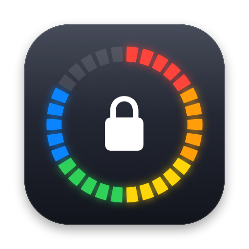

<p align="center"></p>

# OTPBar

macOS 菜单栏两步验证（TOTP）验证码工具。点一下菜单栏的 🛡 图标，点账户即复制验证码。

添加、编辑账户和设置都在独立的普通窗口中进行：切换到浏览器复制密钥时窗口不会消失；窗口打开期间应用会出现在 Dock 和 ⌘Tab 中，全部关闭后回到仅菜单栏模式。

## 功能

- **一键复制**：点击账户行复制验证码；`⌘1`–`⌘9` 快速复制前 9 个；搜索后按 `↩` 复制第一个结果
- 右键菜单：复制下一个验证码（快过期时用）、编辑、在菜单栏中隐藏、管理账户、复制 otpauth 链接、删除
- 账户管理（设置 › 账户）：拖动调整顺序、开关控制是否在菜单栏显示、编辑、删除
- 彩虹倒计时条：6 色 × 5 格，每秒熄灭一格，最后 5 秒红色格子跳动
- **添加账户**（独立窗口，可连续添加多个）：
  - 扫描屏幕：框选屏幕上的二维码
  - 剪贴板：otpauth 链接或二维码图片
  - 图片文件（可多选）
  - 粘贴链接 / 手动输入密钥
  - 支持 **Google 身份验证器“转移账户”导出**（`otpauth-migration://`）批量导入
- 支持 SHA1 / SHA256 / SHA512，6–8 位，30/60 秒周期
- 安全：账户保存在系统**钥匙串**；复制时标记为隐藏内容（剪贴板管理器不会记录），可设置自动清空剪贴板
- 设置：复制后自动关闭面板、验证码分组显示、登录时启动、界面语言、导出/导入明文备份
- 多语言：简体中文、English，默认跟随系统，也可在 设置 › 通用 › 语言 中切换

## 构建

只需要 Command Line Tools（`xcode-select --install`），不需要 Xcode。

```bash
./build.sh            # 生成 build/OTPBar.app
./build.sh --install  # 安装到 /Applications 并启动
./build.sh --test     # 运行 RFC 6238 测试向量等自检
```

需要 macOS 13 及以上。

## 多语言

源代码中的中文字符串本身就是翻译的 key，英文翻译在 `Resources/en.lproj/Localizable.strings`，带复数的放在 `Localizable.stringsdict`。新增或修改界面文字后运行 `./build.sh --test`，会列出缺少英文翻译的字符串。

添加新语言：新建 `Resources/<语言代码>.lproj/`，复制英文的两个文件进去翻译，再把语言代码加到 `build.sh` 的 `CFBundleLocalizations` 中。

## 说明

- 应用使用临时（ad-hoc）签名。**每次重新编译后**首次读取钥匙串时，系统会弹窗询问，选“始终允许”即可。
- “扫描屏幕”首次使用时可能需要在 系统设置 › 隐私与安全性 › 屏幕与系统录音 中允许 OTPBar。
- 只支持 TOTP（基于时间），不支持 HOTP（基于计数器）。

## 目录

```
Sources/OTPCore/OTP.swift        TOTP 算法、Base32、otpauth / migration 解析
Sources/OTPBar/Store.swift       钥匙串存储、剪贴板、二维码识别
Sources/OTPBar/Views.swift       菜单栏界面
Sources/OTPBar/OTPBarApp.swift   入口
Sources/otp-selftest/main.swift  自检
Resources/*.lproj                翻译
tools/check-i18n.py              检查缺失的翻译
tools/make-icons.swift           绘制图标
```
